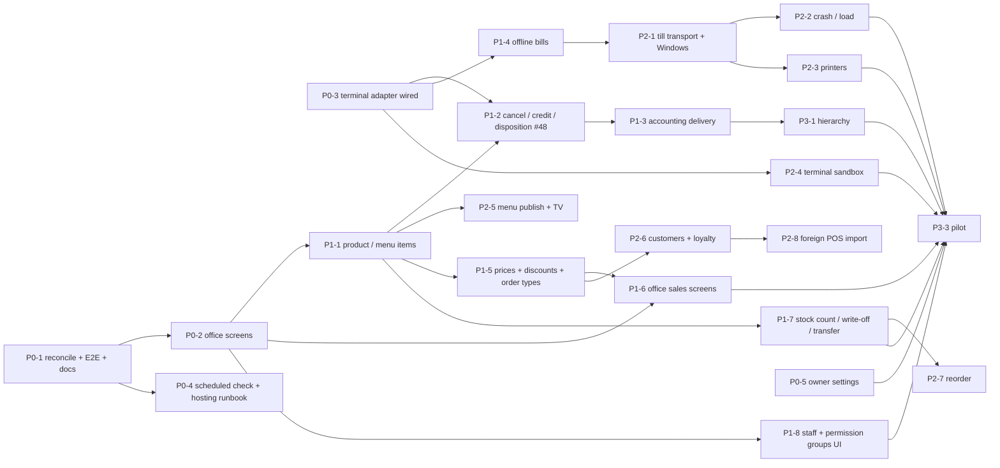

# AXAR ONE — dependency-ordered delivery roadmap (#60)

**Basis:** `docs/AXAR_ONE_SYSTEM_INVENTORY.md` and `docs/INTEGRATION_MATRIX.md` (both from `main` @ `1b7a3af`).

**Rules for every step:**
- one small draft PR per step;
- tests and their results in the PR;
- no merge to `main` or production deploy without the owner's separate approval;
- no real payments, no data deletion, no secrets.

**Responsibility:** Claude owns the technical decisions, implementation, tests and documentation. The owner decides only business questions (provider, hardware, cost, contracts) and repository / production settings. For each such question this document gives 2–3 options and a recommendation.

## Kokkuvõte eesti keeles

**Järjekord:**
1. **P0:** turva- ja kooskõlakontrollid, kontori ekraanid funktsioonidele, millel praegu on ainult API, ning majutuse ettevalmistus.
2. **P1:** üks täielik andmeahel, mis töötab ilma arendajata:
   - tootekaart → kassa → makse → köök → ladu → aruanne → raamatupidamine;
   - arve tühistus, kreeditarve ja tagastus koos laokandega.
3. **P2:** päris seadmed ja katkestused:
   - kassa paigaldus Windowsile ja Androidile;
   - printer;
   - terminali liivakast;
   - koormustest 10 müügikohaga.
4. **P3:** ülejäänud moodulid ja ühe müügikoha piloot.

**Lisatud kontori vaheanalüüsi põhjal** (`docs/BACKOFFICE_REQUIREMENTS_ET.md` §11):
- **P1-5** hinnakirjad, soodustused, makseviisid ja tellimuse tüübid;
- **P1-6** kontori müügivaated (arved, koondaruanne, vahetuste ajalugu);
- **P1-7** inventuur, mahakandmine, ladudevaheline liikumine;
- **P1-8** kasutajad, seadmed ja õiguste grupid kontoris;
- **P2-6** kliendid ja lojaalsus, **P2-7** taastellimine, **P2-8** import teistest kassasüsteemidest.

Piloot (P3-3) ootab nüüd ka sammude P1-6, P1-7 ja P1-8 valmimist.

**Kuidas iga samm sünnib** (rollid, etapid, väravad, tööriistad): `products/axar-one/architecture/13-delivery-journey.md`.
**Registrite kaart ja muudatuste teekonnad:** `products/axar-one/architecture/12-register-map-and-journeys.md` ja ADR-0015.

**Järgmine PR (P0-2):** kontoriekraan kolmele funktsioonile, millel praegu on ainult API:
- **kassa seaded** — offline-piirang, omaniku otsus;
- **võrguühenduseta kirjete läbivaatus** — kordamine või tagasilükkamine;
- **registrite kooskõlakontroll.**

**Mõõdetav valmimiskriteerium:** brauseritest tõestab kolm asja.
1. Juht muudab piirangu 72 h → 24 h ja kassa saab uue piirangu järgmisel ühendusel.
2. Juht kordab karantiinis olevat kirjet ja see rakendub täpselt üks kord.
3. Kooskõla leht näitab 13 kontrolli olekut; tahtliku rikkumise korral muutub vastav rida punaseks.

**Sinu otsustada (äriotsused, mitte tehnilised):**
- **kaarditerminali pakkuja** (§4);
- **keskserveri majutus** (§4);
- `main`-i kaitse sisselülitamine;
- hoidla privaatseks muutmine;
- veebilehe turvauuenduse (#51) avaldamine.

## 1. Ordered work list

| Step | PR / issue | Content | Depends on | Acceptance criteria (measurable) | Test command | Owner | Risk |
| --- | --- | --- | --- | --- | --- | --- | --- |
| **P0-1** | this PR (#60) | inventory + integration matrix + roadmap; `reconcile.check` R1–R13; `/admin/reconciliation`; `/admin/trace/sales/{id}`; one-day E2E chain test; tamper tests | — | 1 business day on 2 registers reconciles with only the honest R8 warning; each of 11 tampered registers is named; R13 on synced till data; mutation check 6 / 6 | `pytest tests/test_e2e_chain_reconciliation.py` (SQLite + `AXAR_TEST_PG`) | Claude | low (read-only code) |
| **P0-2** | next PR | office screens for: POS settings (offline limit), sync quarantine (retry / dismiss with reason), reconciliation + trace | P0-1 | browser test: limit 72 → 24 h reaches the till on the next contact; quarantined entry retried once (no duplicate sale); reconciliation page shows 13 rows; a tampered register turns its row red | `pytest tests_e2e/test_office_admin.py` | Claude | low |
| **P0-3** | PR | wire `terminals/` (provider-neutral adapter) into `payments.py`; the sandbox replaces the inline mock; unknown → reconcile path unchanged | — | all `test_payments.py` + `test_terminal_contract.py` pass through the adapter; no direct `MockTerminalTxn` writes left in `payments.py`; still **SIMULATED** | `pytest tests/test_payments.py tests/test_terminal_contract.py` | Claude | medium (payment path; covered by 23 + 20 tests) |
| **P0-4** | #62 | scheduled reconciliation in the worker (every N min) → audit event + health flag; hosting runbook (TLS, backups off-site, restore drill, monitoring, incident) for the chosen host | P0-1; owner: hosting decision §4 | a failing rule raises a health flag within one worker cycle (test); runbook reviewed; restore drill on the target host documented with timings | `pytest tests/test_reconcile_schedule.py` | Claude (code, runbook), owner (host account) | medium |
| **P0-5** | owner settings | apply branch protection (`products/axar-one/ops/BRANCH_PROTECTION.md`); private repo decision; approve #51 (critical `next`) | — | settings evidence (screenshot / API read-back); `npm audit` clean on the website | — | owner | high until done |
| **P1-1a** | #61 | product group tree, product card, **price lists per outlet** with price versions (`valid_from`), **four-eyes price approval** (creator cannot approve), `pricing.price.published`, R14; deactivation never touches stock; tills pick up changes without restart (scope locked in `docs/discovery/catalog.md` §8) | P0-2 (office shell) | browser test: "Seljanka" 6.50 at outlet A and 6.90 at outlet B; a second manager approves; both tills show their price; the creator's own approval is refused; an old sale keeps its historic price; R1–R14 green | `pytest tests_e2e/test_product_to_sale.py` | Claude | medium |
| **P1-1b** | #61 | weighted goods: decimal quantity (`qty_micro`) on order, sale and refund lines, unit on product (pcs / kg), manual weight entry, line rounding; additive migration converting existing integer lines | P1-1a | sale of 0.352 kg posts the right gross / VAT / stock; refund of part of a weighed line; migration up / down / up; R1–R13 green on converted data | `pytest tests/test_weighted_goods.py` | Claude | medium (touches money path) |
| **P1-1c** | #61 | recipe extension: input unit + conversion, loss %, order-type lines, warnings (unit mismatch, zero cost, food-cost % over limit), `recipe.version.published` | P1-1a | a recipe in grams consumes kg stock correctly; a 1 g schnitzel triggers the warning before publishing; a takeaway-only box is consumed only on takeaway orders | `pytest tests/test_recipe_extension.py` | Claude | low |
| **P1-2** | #48 | cancel / correct / credit / refund with per-line disposition: restock (sealed goods only), write-off with waste reason, no movement; never restock prepared food as raw ingredients; append-only reversal documents; approvals | P1-1, P0-3 | the #48 test list: duplicate cancel once, 2-of-3 lines, sealed drink restocked + burger written off, card refund timeout → unknown not doubled, offline replay, reports + stock + export reconcile (R1–R13 green) | `pytest tests/test_cancellations.py` | Claude (code), owner's accountant (legal review) | high (legal / VAT) |
| **P1-3** | #4, PR #8 | accounting delivery: export_queue → adapter (AXAR CONNECT v2 or an accountant-approved file export) with acknowledgement; R8 becomes "ok" | P1-2 | every queued row acknowledged exactly once with a receipt id; retry never double-posts; journal preview balances (debits = credits) | `pytest tests/test_books_delivery.py` | Claude + AION; owner's accountant (format) | medium |
| **P1-4** | #29 | offline table bills (split / card / transfer) applied centrally instead of quarantined | P0-3 | O1b soak extended with bills: every bill on central exactly once, tenders equal | `pytest tests/test_payments_offline.py` | Claude | medium |
| **P1-5** | new (G02, G13–G15) | price lists per **order type** (per-outlet lists already in P1-1a), modifier / special-request groups, discounts (manual + automatic, %, amount, validity window, outlet / group scope, combinable flag, role limit), payment-method register (type, tip allowed, archived), order types (dine-in / takeaway / delivery → price list, service charge) | P1-1 | browser test: a 10 % staff discount limited to the manager role is refused for a cashier and applied for a manager; a takeaway order uses the takeaway price list; discount + payment totals reconcile (R1–R13 green); old sales keep historic discount and price | `pytest tests_e2e/test_pricing_discounts.py` | Claude | medium (VAT on discounted lines) |
| **P1-6** | new (G08–G11, G28) | office sales screens on existing APIs: invoice list + filters, B2B invoice + bank matching UI, summary report (order type / payment / discount / group breakdowns), shift (Z) history with expected vs counted cash; business-day start setting | P0-2, P1-5 | browser test: a day with 2 registers shows summary totals equal to `daily_summary` and reconciliation; a bank line is matched to an invoice in the UI; a night sale after midnight lands in the right business day | `pytest tests_e2e/test_office_sales.py` | Claude | low |
| **P1-7** | #14 (G18, G19, G21) | stock count (inventory with quantity and money difference, close = approval), write-off with reason, transfer between warehouses, stock as of a past date, document numbering per type | P1-1 | count of 3 items posts exactly the differences once; transfer keeps total value; stock-as-of-date equals replayed movements; new R-rule + tamper test | `pytest tests/test_stock_count_transfer.py` | Claude | medium |
| **P1-8** | new (G24–G27) | staff, device and enrollment-code office UI on the existing API; permission groups as data (fine-grained till + office permissions, default groups = today's 5 roles); company data fields; till action log view | P0-2 | browser test: owner creates group "Teenindaja" without "delete line after interim bill"; that user is refused at the till, a manager approves; log shows both actions; existing role tests unchanged | `pytest tests_e2e/test_office_staff.py tests/test_auth.py` | Claude | medium (auth path) |
| **P2-1** | #29 O5 | sync agent HTTP transport (TLS, device token), Windows packaging (installer, SQLCipher, auto-start), Android spike | P1-4 | a Windows VM till sells 72 h offline, reconnects, R13 green; installer reproducible from CI | packaging CI job + `pytest tests/test_offline_sync.py` | Claude; owner: target hardware | high |
| **P2-2** | #42 | crash / power-loss (VM hard reset during writes), 10-outlet load (10 tills × 2 h simulated trading), chaos on the worker | P2-1 | 0 lost or doubled sales; R1–R13 green after every scenario; p95 sale latency reported | `pytest tests_load/` (new) | Claude | medium |
| **P2-3** | #25 | receipt + kitchen printing: print queue, local bridge, ESC/POS, templates, printer-offline fallback | P2-1 | hardware-in-the-loop on the chosen printer; offline printer → job queued, never lost, never printed twice | HIL checklist + unit tests | Claude; owner: printer purchase | medium |
| **P2-4** | #25 | real terminal in the provider's **sandbox** (after the owner's provider choice and sandbox access) | P0-3, owner decision §4 | sandbox run: approve, decline, timeout → unknown → reconcile, refund / reversal | provider sandbox suite | Claude; owner: contract | high (provider onboarding time) |
| **P2-5** | #40 | menu publish to POS and TV boards (versioned, scheduled) | P1-1 | a published menu version reaches tills and a TV page; the sales history keeps old names and prices | `pytest tests_e2e/test_menu_publish.py` | Claude | medium |
| **P2-6** | new (G07, G22, G23) | customer register + CSV import, B2B payment terms, customer card, birthday and tier discounts (on top of P1-5), sale restrictions by time / age per outlet | P1-5 | customer imported from CSV gets their tier discount at the till; an age-restricted product asks for confirmation; GDPR export / delete of one customer | `pytest tests/test_customers.py` | Claude; owner: privacy notice | medium (personal data) |
| **P2-7** | new (G20) | reorder levels, reorder proposal → purchase order, stale-stock report | P1-7 | items below the level produce one purchase-order draft per supplier; stale report matches a seeded scenario | `pytest tests/test_reorder.py` | Claude | low |
| **P2-8** | new (G32) | importer for other POS systems' export files (products, groups, prices, recipes, customers, suppliers, opening stock) with preview, field-mapping profile and dry run | P1-1, P1-5, P2-6 | a sample export of 2 500 products imports with a dry-run report, then for real; re-import is idempotent; reconciliation green | `pytest tests/test_import_foreign.py` | Claude; owner: anonymised sample files | medium |
| **P2-9** | new (owner answer 26.11) | gift cards: rule (uses, value, validity days / date, partial use, reusable, number generated / read), sale = liability not revenue, redemption as payment method, issued / used / expired report; allergens on menu and receipt | P1-5, P1-3 | a 50 € card sold, used 20 € + 30 €, then refused; books show liability → revenue on redemption; expiry report lists an unused card | `pytest tests/test_gift_cards.py` | Claude; owner's accountant (liability treatment) | medium |
| **P3-1** | #27 | hierarchy: legal entity → site → outlet → register + warehouse (ADR-0013, additive migration + backfill) | P1-3 | migration up / down / up on a copy of pilot data; RLS tests per entity; reports per outlet | `pytest tests/test_hierarchy.py` | Claude; owner: real outlet list | medium |
| **P3-2** | #38, #39, #18, #33, #32, #31 | chef workspace, guest QR, people / HACCP, CONTROL dashboard, extensions, in dependency order after the pilot path | P1–P2 | per issue | per issue | Claude | scope |
| **P3-3** | #44 | 1-outlet shadow pilot (2 weeks, daily reconciliation report), then step-by-step expansion | P0–P2 complete | 14 days, every day R1–R13 green or explained; accountant sign-off | daily `/admin/reconciliation` export | owner + Claude | operational |

## 2. Dependency graph

## 3. Definition of done for every PR

1. Draft PR with base `main`; description lists what changed, its impact, tests run, and what is still not proven.
2. SQLite and PostgreSQL suites green locally and in CI. The 7 required checks:
   - `secret-scan`
   - `sast-python`
   - `changes`
   - `test`
   - `test-postgres`
   - `browser-e2e`
   - `dependency-audit`
3. A migration only if needed. It must be additive, with an up / down / up check, and `tests/test_migration_history.py` must stay single-head.
4. `reconcile.check` stays green on the new flows. New registers get a new R-rule plus a tamper test.
5. Vercel skips the build (only `products/` or `docs/` change); production unchanged.
6. No merge or deploy without the owner's separate approval.

## 4. Business decisions for the owner (options + recommendation)

### Card terminal provider (blocks P2-4; P0-3 does not wait)

| Option | For | Against |
| --- | --- | --- |
| A. A provider with a published ECR / cloud terminal API and a public sandbox (the #25 research shortlisted Revolut, Nexi, Worldline) | integration can start in the sandbox before any contract; fastest path to a tested flow | fees and contract terms differ; check acceptance of local cards |
| B. The owner's current bank's terminal | one bank relationship | the #25 research could **not** verify an integration API (LHV); may be impossible to integrate |
| C. Stand-alone terminal (amount typed by hand) for the pilot | no integration work | double entry, typing errors, no automatic reconciliation (R3 cannot cover the card leg) |

**Recommendation:** A. Request sandbox access from two shortlisted providers. Claude compares the APIs against the adapter contract (`terminals/`) before the owner signs anything. Nothing is bought until the owner approves.

### Central server hosting (blocks P0-4 and the pilot)

| Option | For | Against |
| --- | --- | --- |
| A. EU cloud: managed PostgreSQL + one container host, off-site backups | managed backups / patching; tills already survive 72 h offline, so a cloud outage does not stop selling | monthly cost; needs an account in the owner's name |
| B. Server on site (zoo) + cloud backup | data stays on site | hardware, power and UPS responsibility; remote access and patching are harder |
| C. Both: cloud central + an edge node per outlet (ADR-0012) | best resilience | most to operate; this is the long-term target anyway |

**Recommendation:** A now, growing into C with P2-1. Claude prepares the runbook and cost comparison. The owner opens the account. No purchase without approval.

## 5. Risks

| ID | Risk | Mitigation | Step |
| --- | --- | --- | --- |
| K1 | Office cannot operate API-only functions (limits, quarantine, bank, staff) | office screens | P0-2, P1-1 |
| K2 | Simulated card path looks "done" | always labelled SIMULATED; adapter wired before any provider work | P0-3, P2-4 |
| K3 | Accounting rows pile up undelivered | R8 warning visible; delivery adapter | P1-3 |
| K4 | Cancellations done "by hand" in the database | #48 documents with approvals; reconciliation flags manual edits | P1-2, P0-1 |
| K5 | Legal / VAT treatment of credits and receipts | accountant review before release | P1-2 |
| K6 | No hosting / monitoring | runbook + scheduled reconciliation alert | P0-4 |
| K7 | Unprotected `main` on a public repository | owner settings | P0-5 |
| K8 | Scope growth before the pilot path | P3 modules only after P2 | all |
