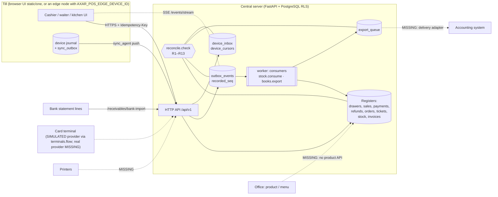
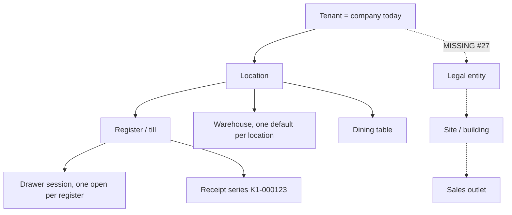
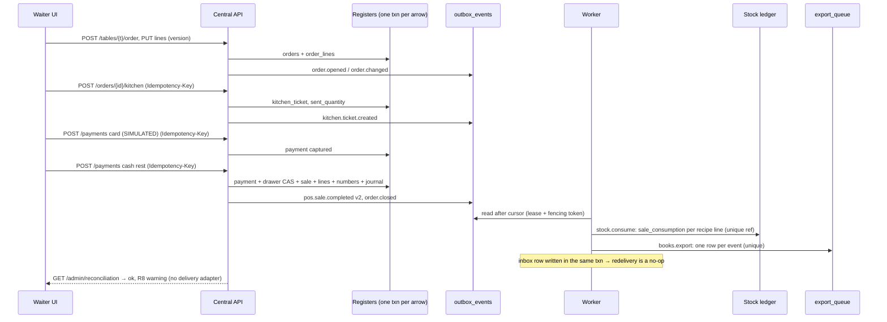

# AXAR ONE — integration matrix and register map (#60)

**State:** `main` @ `1b7a3af` + this PR. Every edge below names the code that implements it. **MISSING** means no code exists; it is not a promise.

## Kokkuvõte eesti keeles

AXAR ONE koosneb registritest:
- kassasahtel;
- müük;
- maksed;
- tagastused;
- tellimused ja köök;
- ladu;
- sündmused;
- raamatupidamise ekspordijärjekord;
- arved;
- kassade sünkroonimine.

Iga registri vahel on üks "serv" ehk ühendus. Iga serva juures on kirjas:
- kes on tõe allikas;
- millise sündmuse või API kaudu andmed liiguvad;
- mis takistab topeltkirjet;
- mis juhtub vea korral;
- milline kooskõlakontrolli reegel (R1–R13) serva valvab.

Ühendamata servad on märgitud **MISSING**:
- menüü avaldamine;
- päris terminal;
- printer;
- raamatupidamise edastus;
- tagastuse laokanne;
- mitme firma hierarhia.

---

## 1. Architecture (as built)



## 2. Organization and register hierarchy



| Level (#27 target) | In code today | Source of truth | Invariant | Test |
| --- | --- | --- | --- | --- |
| Legal entity | = tenant (one company per tenant) | `tenants` | RLS: every row carries `tenant_id` | `test_postgres.py`, `test_tenancy_and_identity.py` |
| Site / building | **MISSING** | — | — | — |
| Sales outlet | ≈ `locations` | `locations` | staff roles may be scoped to a location | `test_auth.py` |
| Register | `registers` (unique code per tenant) | `registers` | one open drawer per register (partial unique index); per-register receipt series is unique | `test_registers_and_concurrency.py`, R5 |
| Warehouse | `warehouses` (default per location) | `warehouses` | a sale consumes from the default warehouse of its register's location; missing default → consumer blocks, nothing is skipped | `test_inventory.py::test_sale_without_default_warehouse_blocks_consumer_instead_of_skipping` |

## 3. Edges

Columns:
- **Key:** the idempotency or correlation key.
- **Txn:** the transaction boundary.
- **Order:** ordering guarantee.
- **Failure:** retry / error / dead-letter / quarantine behaviour.
- **Recon:** which reconciliation rule (this PR) guards the edge.

| # | Edge | Source of truth | Interface (version) | Key | Txn | Permission | Order | Failure | Recon | Tests |
| --- | --- | --- | --- | --- | --- | --- | --- | --- | --- | --- |
| E1 | Catalog / price → till button | `products` | `GET /api/v1/products` | product id | read | `catalog.read` | — | — | — | `test_quote_and_ui_assets.py` |
| E2 | Price → sale line | `products` at sale time | `POST /sales/quote`, `/sales/cash` | sale line snapshot | the sale | `sale` | — | price changed while settling → `BillChanged` | R2 | `test_sales.py` |
| E3 | Recipe → consumption | `recipes` (versioned, `valid_from`) | consumer `stock.consume` | `(sale, line, item)` unique movement | consumer txn | worker | per tenant `recorded_seq` | no recipe for that date → consumer **blocks** (`on_poison=block`) | R9, R10 | `test_inventory.py` |
| E4 | Menu publish → POS / TV | **MISSING** | — | — | — | — | — | — | — | — |
| E5 | Express cash sale → sale register | `sales`, `sale_lines` | `POST /sales/cash` → `pos.sale.completed` v1 | `Idempotency-Key` (`uq_sale_idempotency`) + request hash | one txn: sale + lines + drawer CAS + numbers + journal + outbox | `sale` + till device | receipt numbers from a row-locked counter | lost response → retry returns the same sale; same key with another body → 409 | R1, R2, R3, R5, R6 | `test_sales.py`, `test_registers_and_concurrency.py` |
| E6 | Order → kitchen | `orders`, `kitchen_tickets` | `POST /orders/{id}/kitchen` → `kitchen.ticket.created` v1, `…ready` v2 | `Idempotency-Key` (`uq_ticket_idempotency`); order `version` (optimistic) | one txn | `orders`; ready: `kitchen.update` | per order version | stale version → 409; replay → same ticket | R11 | `test_orders.py`, `test_cross_device_orders.py` |
| E7 | Bill → payments → sale | `payments`, then `sales` | `POST /orders/{id}/payments` → `pos.sale.completed` v2 (tenders) | `Idempotency-Key` (`uq_payment_idempotency`) | each payment one txn; the last settling payment issues the sale in the same txn | `orders` / `sale` | bill state frozen once partly paid | card `unknown` → bill blocked until `/payments/{id}/reconcile` | R3, R11 | `test_payments.py` |
| E8 | Card payment → terminal | provider side: `mock_terminal_txns` (SIMULATED, own transaction); POS side: `payments` | `terminals.flow.charge` / `.resolve` over a `TerminalAdapter` (`terminals/recorded.py`) | our payment id = provider attempt id | 1) attempt recorded `unknown` + committed, 2) terminal asked outside any POS txn, 3) answer recorded | `sale` + till device | bill lock per step | not sent → declined; lost answer → unknown → `/payments/{id}/reconcile`; completing tender checks the drawer BEFORE the terminal; receipt not issuable after approval → payment kept, `/orders/{id}/settle` | R3, R11 | `test_card_terminal_flow.py`, `test_payments.py` |
| E8b | Real provider adapter | — | same `TerminalAdapter` contract | — | — | — | — | must pass `test_terminal_contract.py` | — | **MISSING** until the owner chooses a provider (roadmap P2-4) |
| E9 | Transfer part → receivable → bank | `customer_invoices`, `bank_transactions` | `/receivables/bank-import` | `bank_tx_id` (`uq_bank_tx`), Estonian reference number 7-3-1 | per import line | `receivables` | — | duplicate bank line → ignored; overpay → `overpaid` | R12 | `test_payments.py` |
| E10 | Sale → refund | `refunds`, `refund_lines` | `POST /sales/{id}/refunds` → `pos.refund.completed` v1 | `Idempotency-Key` (`uq_refund_idempotency`) | one txn: refund + allocation CAS + drawer CAS | `refund.request` + manager approval | per sale CAS on `sale_refund_state` | over-refund refused under concurrency; mixed-tender sale cannot be refunded in cash | R1, R4, R6 | `test_refunds.py`, `test_refund_allocation.py` |
| E11 | Refund → stock (restock / write-off) | **MISSING** | — | — | — | — | — | refunds never restock today (explicit in `consumers.stock_consume`) | — | #48 |
| E12 | Sale / refund → accounting | `outbox_events` → `export_queue` | consumer `books.export` | `(tenant, destination, event)` unique | consumer txn | worker | per tenant `recorded_seq`, block on poison | payload hash mismatch → dead letter, consumer stops | R6, R7, R8 | `test_events.py` |
| E13 | Export queue → accounting system | **MISSING** (no delivery, nothing is acknowledged) | AXAR CONNECT PR #8 (v1 only) | `event_id` + receiver receipt id | — | — | — | rows wait as `pending` | R8 (warning) | PR #8 suite |
| E14 | Drawer ↔ cash ledger | `drawer_sessions` running totals vs `sales` / `payments` / `refunds` | `POST /drawer/{id}/close` | drawer id | close txn re-computes from the ledger, refuses on mismatch | `drawer` (+ manager for variance) | one open drawer per register | mismatch → `LedgerMismatch`, nothing closed | R1 | `test_drawer_and_reports.py` |
| E15 | Sales → reports | `sales`, `refunds` | `GET /reports/daily` (read model computed on request) | business date | read | `reports` | — | — | R2, R4 (same sources) | `test_drawer_and_reports.py`, this PR |
| E16 | Offline till → central | till `device_journal` + `sync_outbox`; central `device_inbox`, `device_cursors` | `POST /sync/push` | `edge:<journal entry ULID>`; inbox unique (tenant, device, seq) | per entry: lock cursor, apply, inbox, commit | the till's own device only | strict `seq`; gap → resend from `acked_through` | chain broken → stream stops; unappliable → `quarantined` (manager retry / dismiss); 423 past the offline limit | R13 | `test_offline_sync.py`, `test_offline_refunds.py`, `test_offline_limit.py` |
| E17 | Events → screens | `outbox_events` | SSE `/api/v1/events/stream` | `recorded_seq` cursor | read | any session | gap-free per tenant | reconnect resumes from the cursor | R7 | `test_events.py`, e2e cross-device |
| E18 | Purchase → stock | `supplier_documents`, `stock_movements` | `/inventory/documents` + `/post` → `stock.changed` | document (unique per supplier + number); post once | one txn | `inventory` (manager) | balance row locks | duplicate document / double post refused | R10 | `test_inventory.py` |

## 4. Sequence: one table sale end to end (as tested in this PR)



## 5. Sequence: offline till

```mermaid
sequenceDiagram
  participant T as Till (edge node)
  participant A as sync_agent
  participant C as Central /sync/push
  T->>T: sale + journal entry + sync_outbox row (one txn)
  A->>C: batch of pending rows (seq order)
  C->>C: per entry: lock device cursor, verify hashes and seq
  C->>C: apply as sale with key edge:<entry id>, or quarantine
  C-->>A: acked_through + per-entry status
  A->>T: mark acked / quarantined; record contact (renews the 72 h window)
  Note over A,C: lost response → resend → "duplicate", nothing changes
```

## 6. Register invariants (enforced in code or checked by `reconcile.check`)

| Rule | Invariant | Enforced at write time | Checked afterwards |
| --- | --- | --- | --- |
| R1 | drawer running totals = Σ cash sales + cash bill payments, Σ cash refunds; expected = float + in − out | CAS updates; close re-computes and refuses on mismatch | `R1.drawer_cash` |
| R2 | sale total = Σ line gross; net + VAT = total | lines priced in the same txn | `R2.sale_totals` |
| R3 | bill sales: Σ settling payments = total; cash: due = total + rounding, tendered − change = due | bill state machine | `R3.tenders` |
| R4 | refunded ≤ sold per line; counters = refund ledger | conditional UPDATE (CAS) | `R4.refunds` |
| R5 | tenant receipt / refund numbers 1..n without gaps; register series without repeats | row-locked counters, unique constraints | `R5.numbering` |
| R6 | exactly one intact `pos.*.completed` event per document, same total | outbox written in the document txn | `R6.events_per_document` |
| R7 | consumers caught up, no unresolved dead letter, no blocked consumer | lease + fencing; block policy | `R7.event_pipeline` |
| R8 | one export row per books event, same payload hash | unique constraint | `R8.books_export` |
| R9 | every consumed sale has a movement for each stocked line | consumer is all-or-nothing per sale | `R9.stock_consumption` |
| R10 | stock balance = Σ movements (qty, value) | balance row locks | `R10.stock_ledger` (= `inventory.reconcile`) |
| R11 | kitchen tickets = sent quantities; settled order has a sale with the same lines | order version + idempotent ticket | `R11.orders_kitchen` |
| R12 | receivable paid ≤ amount; status follows | bank import per line | `R12.receivables` |
| R13 | each accepted till entry created exactly one central document | inbox unique per (device, seq); key `edge:<id>` | `R13.offline_sync` |

**Observability today:**
- `/admin/event-health`: consumer lag and dead letters;
- `/admin/reconciliation`: R1–R13;
- `/admin/trace/sales/{id}`;
- the audit log `auth_events`.

**Missing:**
- metrics export;
- alerting;
- log shipping;
- a hosted environment to run them in (roadmap P0-4).
