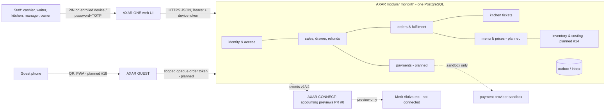
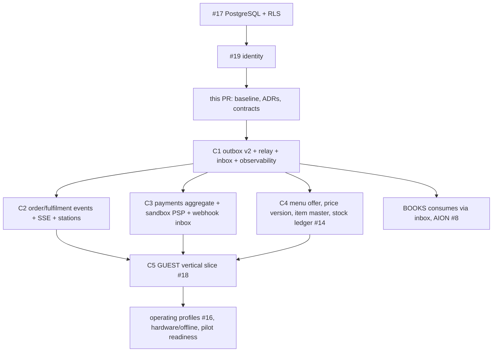

# 01 — System context, modules and dependency DAG

## System context

Trust boundaries:
- browser ↔ API (untrusted input; server authoritative);
- provider webhooks (untrusted until signature verified);
- CONNECT ↔ external books (not connected).

See `06-trust-and-permissions.md`.

## Logical modules (capabilities, not services)

| Module | State | Code today |
| --- | --- | --- |
| IAM | **built** (slice 6) | `axar_pos/auth.py`, migration 0002 |
| POS (sale, drawer, refund) | **built** | `axar_pos/services.py` |
| ORDERS / KDS | **built**, basic (`open/paid`, `new/ready`) | `axar_pos/orders.py` |
| OUTBOX | write-only v1 | `models.OutboxEvent` |
| BOOKS (CONNECT) | previews, separate package | PR #8 `products/axar-connect` |
| UI (AXAR ONE) | built on the API | `axar_pos/static/one` |
| PAY, MENU, STOCK, GUEST, NOTIFY, WORKFLOW, RECON | **not built** | — |

## Module dependency rules

- Writes are owned by one module (see `03-data-ownership.md`). Other modules call its service functions (synchronous command, same transaction where an invariant needs it) or react to its events (asynchronous, through the inbox).
- **No cycles.** The allowed direction is IAM ← everything; MENU ← ORDERS ← POS/PAY; STOCK reacts to events from ORDERS/POS/PAY; BOOKS reacts to POS/PAY/STOCK; NOTIFY and GUEST react to ORDERS/KDS.
- Read models (KDS screen, guest status, reports) are derived and rebuildable from authoritative tables plus events.

## Delivery DAG (draft PRs)

Each node has measurable acceptance criteria in `08-requirements-to-tests.md`.
