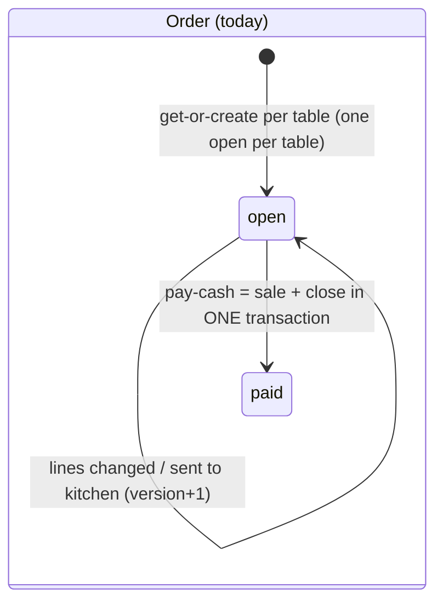
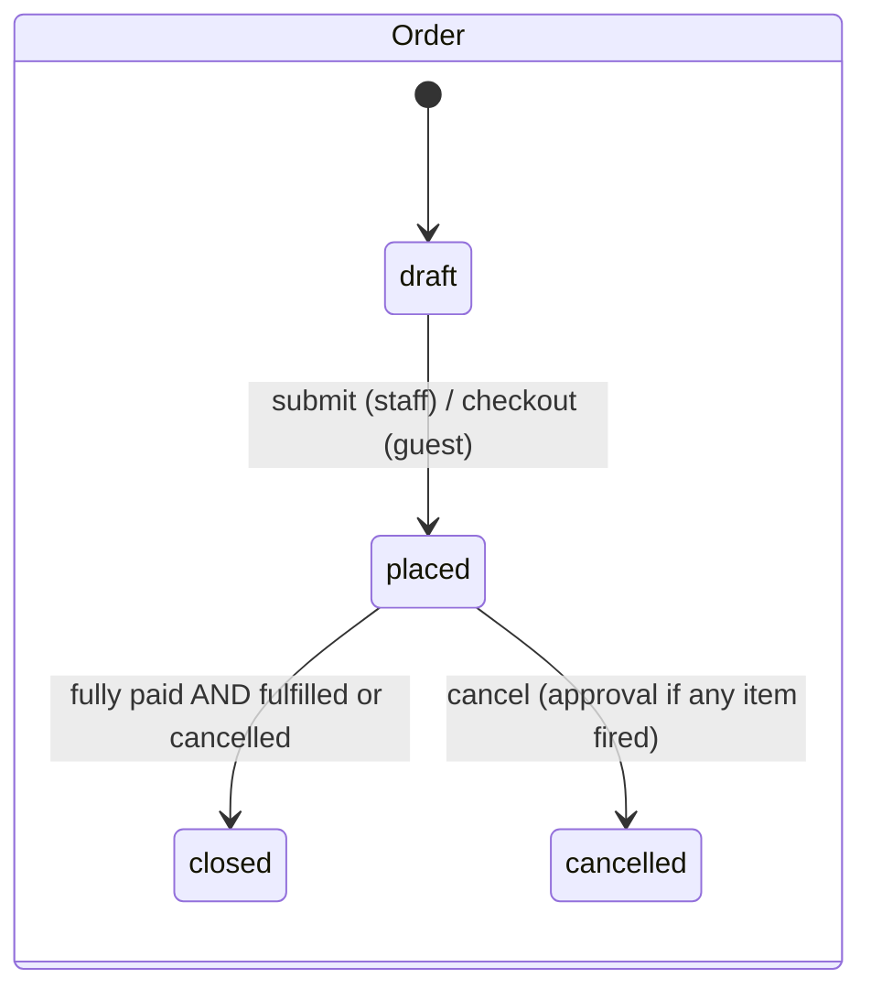
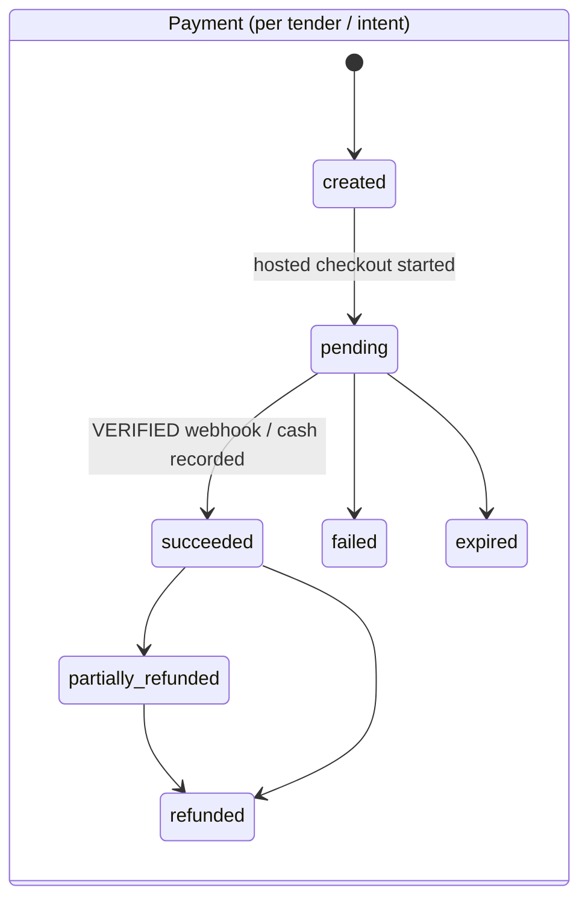
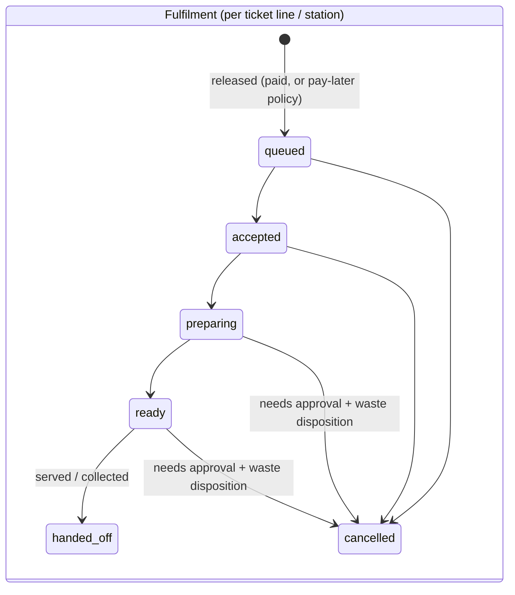
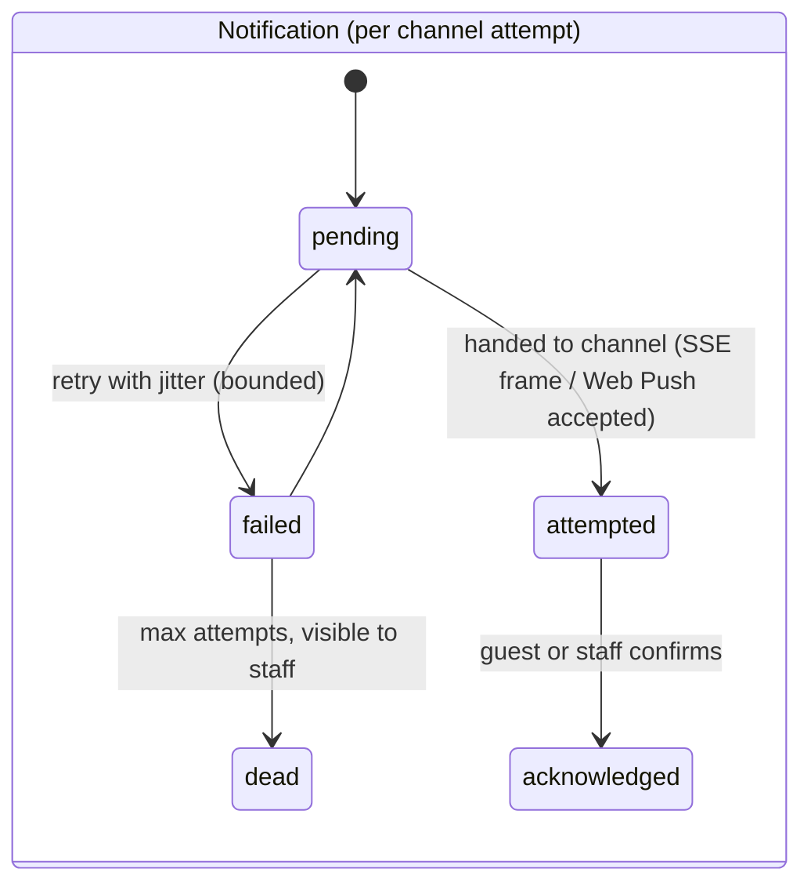
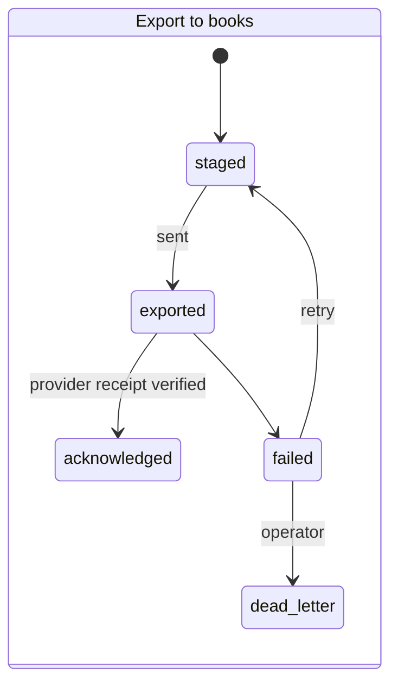

# 05 — State machines

Each lifecycle is **separate**. A single overloaded status (G-DM-3) is what this replaces. Transitions are compare-and-swap updates (`WHERE state = :from AND version = :v`) and every transition emits an event.

## Built today

```mermaid
stateDiagram-v2
  direction LR
  state "Drawer session" as D {
    [*] --> open: open (float)
    open --> closed: close (counted; variance≠0 needs manager or step-up)
  }
```


## Target (C2/C3)





"attempted" is never shown as "delivered" (#18 owner gate).



## Cross-lifecycle rules

| Rule | Enforced by |
| --- | --- |
| Kitchen release only after a verified payment, or an explicit pay-later policy (table service) | ORDERS command checks PAY state in the same transaction |
| A redirect "success" from the provider never changes the payment state; only a verified webhook does | PAY webhook inbox + signature check |
| Payment succeeded but stock unavailable → exception + refund workflow, never a silent cancel | WORKFLOW (C3/C4) |
| A refund does not restock food automatically; the line carries a disposition (`restock` / `waste` / `none`) | `pos.refund.completed` v2 |
| A sale consumes either the recipe version or finished stock, never both | STOCK consumption rule (#14) |
